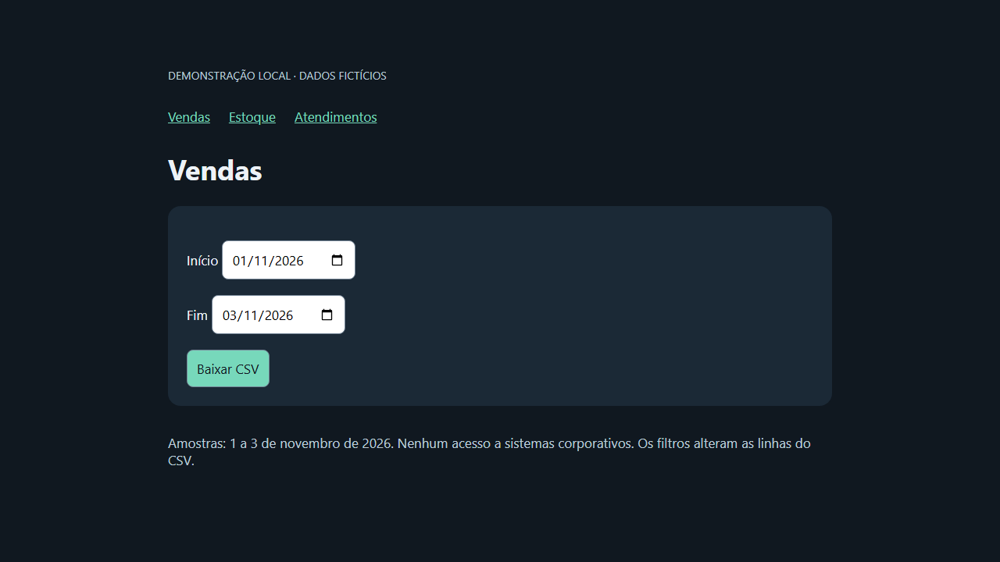

# RelatPy — automação de relatórios web

**Estudo de automação em Python com interface local, worker independente e execução assíncrona.**

O RelatPy organiza tarefas de geração de relatórios: seleção de período, execução dos fluxos, acompanhamento de status, downloads e tratamento de falhas. O projeto explora problemas comuns de automação operacional, como esperas de interface e separação entre a janela de acompanhamento e o processo executor.

**Estado atual:** amostra pública sanitizada com uma demonstração local executável de ponta a ponta. O demo usa um site fictício, três relatórios CSV e o executor assíncrono existente. Os módulos operacionais e a configuração privada não são distribuídos.

## Experimente a demonstração

Requer Python 3.12+. Na raiz, depois de preparar um ambiente virtual:

```powershell
python -m pip install -r requirements-demo.txt
python -m playwright install chromium
python -m demo.run --inicio 2026-11-01 --fim 2026-11-03
```

O comando inicia um site somente local, preenche o período em três abas e baixa os CSVs em paralelo. Arquivos, captura da página e status ficam em `demo-output/`. Use `--headed` para acompanhar o navegador. Todos os registros são fictícios; o demo não acessa sistemas da empresa.

[Guia completo, arquitetura e validação](docs/DEMO.md) · [Workflow do demo](.github/workflows/demo.yml)



## Stack

Python, asyncio, Playwright, Streamlit, Tkinter, subprocess, JSON, pathlib e scripts de inicialização Windows. Há preparação para empacotamento e distribuição local.

## Código disponível

- Interface Streamlit para parametrizar período e acompanhar execuções.
- Launcher e worker em processos separados.
- Orquestração assíncrona com limite de concorrência.
- Estados de execução e persistência de status em JSON.
- Rotinas de download, arquivos, cancelamento e diagnóstico.
- Ferramentas para revisar e sanitizar a publicação.

| Responsabilidade | Arquivo |
| --- | --- |
| Interface | [streamlit_app.py](ui/streamlit_app.py) |
| Execução independente | [worker.py](worker.py) |
| Concorrência e persistência de status | [executor.py](core/executor.py) |
| Orquestração de downloads | [downloader.py](downloader.py) |
| Controle da aplicação | [app_control.py](core/app_control.py) |
| Revisão de publicação | [auditar_publicacao.py](tools/auditar_publicacao.py) |

O executor usa arquivo temporário e substituição para atualizar o status, reduzindo o risco de leitores encontrarem um JSON parcialmente gravado. A execução em worker separado evita vincular todo o processamento à sessão visual do Streamlit.

## Limites da amostra pública

| Item | Situação |
| --- | --- |
| Seletores, URLs e fluxos privados | Intencionalmente não distribuídos |
| Configuração de relatórios | `downloader.py` depende de `config.RELATORIOS`, ausente na amostra |
| Entrada de execução manual | Contém substituição sanitizada que precisa ser corrigida antes de funcionar |
| Demonstração independente | `python -m demo.run`, com site local e dados fictícios |
| Testes de comportamento e CI | Datas, filtragem, HTTP e downloads em Chromium; workflow `Public demo` |

O erro da entrada manual envolve atribuir uma string sanitizada a duas variáveis por desempacotamento. A solução deverá fornecer um contrato de credenciais e um fluxo fictício; recolocar dados privados não é necessário.

A limitação pertence à versão distribuída. Não há comprovação pública de métricas de economia de tempo ou taxa de sucesso, portanto esses resultados não são afirmados aqui.

## Preparação do ambiente

Requer Windows 10/11, Python 3.12 recomendado e navegador compatível. Na raiz, em PowerShell:

```powershell
py -3.12 -m venv .venv
.\.venv\Scripts\python.exe -m pip install -r Requisitos.txt
.\.venv\Scripts\python.exe -m pip check
```

O nome versionado é `Requisitos.txt`, com R maiúsculo.

A entrada de interface é `ui/streamlit_app.py`. O comando abaixo documenta o ponto de entrada, mas não supera a ausência da configuração e dos módulos privados:

```powershell
.\.venv\Scripts\python.exe -m streamlit run ui/streamlit_app.py
```

Para uma adaptação, implemente configuração e módulos próprios somente em páginas autorizadas. O próximo MVP público deve usar um site local fictício e gerar arquivos de exemplo sem exigir acesso corporativo.

## Validação disponível

```powershell
.\.venv\Scripts\python.exe tools/auditar_publicacao.py
```

A auditoria de publicação e a verificação de dependências não equivalem a testes funcionais de download, cancelamento ou recuperação.

Antes de publicar, revise também [o checklist](PUBLICATION_CHECKLIST.md). Não inclua credenciais, sessões, relatórios reais, endereços internos, logs operacionais ou capturas de aplicações privadas.

## Próximas entregas, em ordem

1. Ampliar o demo com testes de falha de download, timeout e cancelamento.
2. Decidir a adaptação da entrada legada; o cenário executável atual usa `demo.run`.
3. Registrar a execução remota do workflow e ampliar a auditoria de publicação.
4. Evoluir a demonstração de acompanhamento na interface, sem módulos privados.
5. Revisar arquivos acidentais na raiz e padronizar formatação e nomes.
6. Registrar um vídeo curto e métricas do cenário fictício, com procedimento de medição.

## Escopo do portfólio

Este projeto serve como evidência de Python assíncrono, automação web, processos e manipulação de arquivos. A proposta do MVP público é permitir avaliar essas competências sem depender de uma organização ou ambiente interno.

[Resumo técnico de portfólio](README_PORTFOLIO.md) · [Auditoria e sanitização](tools/SANITIZADOR_README.md)
