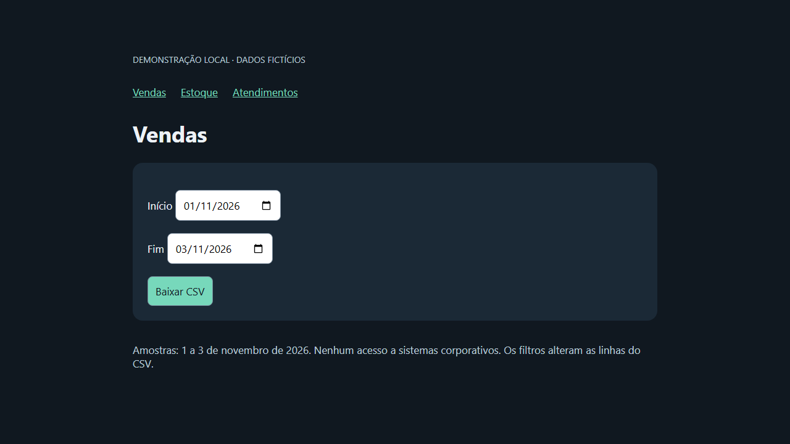

# Demonstração local reproduzível

O site é fictício, roda somente em `127.0.0.1` e não pede credenciais.
Vendas, estoque e atendimentos têm três registros sintéticos cada, de 1 a 3 de
novembro de 2026. Datas fora da amostra geram CSV somente com cabeçalho.

## Executar em um clone novo

Requer Python 3.12+ e acesso à internet somente para instalar as dependências.
Na raiz, em PowerShell:

```powershell
python -m venv .venv
.\.venv\Scripts\python.exe -m pip install -r requirements-demo.txt
.\.venv\Scripts\python.exe -m playwright install chromium
.\.venv\Scripts\python.exe -m demo.run --inicio 2026-11-01 --fim 2026-11-03
```

Linux/macOS: use `.venv/bin/python` no lugar de `.\.venv\Scripts\python.exe`.
Em Linux, a instalação pode exigir `python -m playwright install --with-deps chromium`.

O comando inicia e encerra o site automaticamente e usa Chromium headless.
Adicione `--headed` para assistir às abas. O servidor usa uma porta livre.
`--output outra-pasta` seleciona o destino; uma nova execução substitui os
arquivos de mesmo nome nesse destino. Execute somente um lote por processo.

Saída padrão em `demo-output/`:

- `vendas.csv`, `estoque.csv` e `atendimentos.csv`, filtrados pelo período;
- `status/status.json`, com o resultado de cada relatório;
- `demo.png`, captura real da página fictícia de vendas.

Para explorar o site manualmente, execute `python -m demo.site`, abra a URL
impressa e selecione um relatório e período. Encerre com Ctrl+C.

## Arquitetura e limites

`demo/site.py` fornece o site e os CSVs via biblioteca padrão Python.
`demo/run.py` preenche os filtros com Playwright, associa o download à aba e ao
relatório esperado e salva o arquivo. As três tarefas passam por
`core/executor.py`: semáforo, execução em lote e status persistido atomicamente.
O navegador bloqueia requisições para fora da origem local da demonstração.

O demo é uma entrada própria: não carrega `auth.py`, `config.py`, módulos
operacionais, Streamlit, rede corporativa ou credenciais. A entrada legada
`main.py` permanece uma amostra sanitizada incompleta; o demo não a torna
operacional. Não há simulação de login, filas de geração, cancelamento ou
recuperação de um processo interrompido nesta entrega.

## Validação

```powershell
.\.venv\Scripts\python.exe -m unittest discover -s tests -v
```

Os testes verificam formato/ordem das datas, filtro inclusivo de CSV, respostas
400/404 e downloads das três abas, com conteúdo correto e status persistido.
O workflow `Public demo` reproduz os comandos em Ubuntu e publica os resultados
como artefato. A execução remota deve ser conferida no GitHub Actions.


